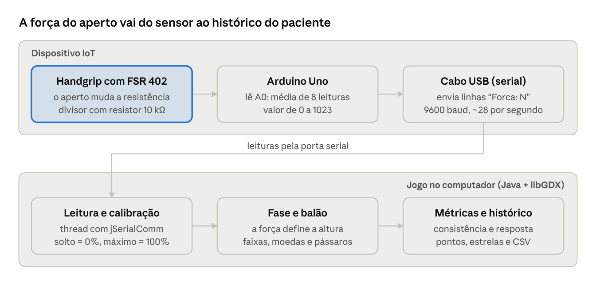

# Jogo do Balão

Jogo sério para reabilitação da força de preensão da mão, feito com libGDX.
O jogador aperta um **handgrip com sensor de força ligado a um Arduino**: quanto mais força, mais o balão sobe.
O objetivo é manter o balão dentro das faixas-alvo, pegando moedas e desviando dos pássaros.
Sem o Arduino, a barra de ESPAÇO simula o aperto, para testes.

Autora: Beatriz Soares — disciplina de Jogos Digitais.

## Entrega

| O que | Onde |
|-------|------|
| Código-fonte | pasta `codigo/` deste repositório |
| Executável | `JogoBalao.jar` (gerado com `codigo/gerar-jar.bat`, veja abaixo) |
| Short paper | [`docs/short-paper-jogo-do-balao.pdf`](docs/short-paper-jogo-do-balao.pdf) |
| Prints do jogo | [`docs/prints/`](docs/prints) |
| Códigos do Arduino | `codigo/arduino/` |
| Montagem do Arduino | [`docs/montagem-handgrip-arduino-fsr402.pdf`](docs/montagem-handgrip-arduino-fsr402.pdf) |



## Organização

```
README.md   este arquivo
codigo/     projeto libGDX completo, pronto para abrir no VS Code ou no IntelliJ
docs/       short paper, guia de montagem do Arduino, prints e diagrama do sistema
```

O projeto não usa Gradle: as bibliotecas do libGDX já vêm na pasta `codigo/libs`,
então não é preciso baixar nada para rodar. Só é preciso o **JDK 17 ou mais novo**
(confira com `javac -version`; se não tiver, instale o JDK 21 ou 25 em https://adoptium.net).

## Jeito mais simples: rodar.bat

Dê dois cliques em **`codigo/rodar.bat`** (Windows). Ele compila o código e abre o jogo.
No Linux ou macOS, rode `./rodar.sh` dentro da pasta `codigo`.

## Executável (.jar)

Para jogar sem compilar, use o **`JogoBalao.jar`**: abre com dois cliques ou com `java -jar JogoBalao.jar`.
Ele já traz as imagens, os sons e as bibliotecas, e foi compilado para **Java 8**, então funciona
também em computadores que só têm um Java antigo instalado.

Para gerar o jar de novo depois de mudar o código, dê dois cliques em **`codigo/gerar-jar.bat`**
(ou rode `./gerar-jar.sh` no Linux e macOS, ou **Terminal > Executar Tarefa > Gerar o .jar** no VS Code).
O arquivo sai em `codigo/dist/JogoBalao.jar`. A pasta `dist` não vai para o repositório.

## Rodar no VS Code (passo a passo)

1. **Baixe o projeto** e extraia em uma pasta, por exemplo `Desktop\jogo-balao`.
2. **Instale a extensão.** No VS Code, abra a aba de extensões (**Ctrl+Shift+X**) e instale
   **Extension Pack for Java** (da Microsoft).
3. **Abra a pasta certa.** **Arquivo > Abrir Pasta…** e selecione a pasta **`codigo`**
   (a que tem as pastas `core`, `libs` e `assets` dentro). Se perguntar, clique em **Sim, confio**.
4. **Rode.** Pressione **Ctrl+Shift+B**. Abre um terminal que compila o código e, em seguida, a janela do jogo.

Também dá para rodar com **F5 > Rodar o jogo**, depois que a extensão Java terminar de carregar
(o "Java: Activating" na barra de baixo). Se o F5 mostrar erros como "cannot be resolved to a type",
aperte **Ctrl+Shift+P > Java: Clean Java Language Server Workspace > Restart and delete** e tente de novo.
O Ctrl+Shift+B funciona mesmo sem a extensão carregada.

## Rodar no IntelliJ IDEA

1. **File > Open** e selecione a pasta **`codigo`**. Aceite **Trust Project**.
2. Se aparecer o aviso "Project JDK is not defined", clique em **Setup SDK** e escolha o JDK instalado.
3. No topo, escolha **Rodar o jogo** e clique no botão verde.

## Handgrip com Arduino (controle IoT)

O dispositivo é um handgrip de mola com um sensor de força FSR 402 colado no cabo, ligado a uma
placa UNO R3: 5V → FSR → pino A0 → resistor de 10 kΩ → GND. O passo a passo da montagem na
protoboard, com desenho, está em [`docs/montagem-handgrip-arduino-fsr402.pdf`](docs/montagem-handgrip-arduino-fsr402.pdf). O Arduino lê o sensor e manda linhas
`Forca: N` (N de 0 a 1023) pela USB, a 9600 baud. Os códigos do Arduino estão em `codigo/arduino/`:
`handgrip_fsr` (sensor FSR), `handgrip_hx711` (alternativa com célula de carga e módulo HX711)
e `teste_sem_sensor` (para testar a conexão antes de montar o sensor).

1. Carregue `codigo/arduino/handgrip_fsr/handgrip_fsr.ino` no Arduino pela Arduino IDE.
2. Feche o Monitor Serial da IDE (só um programa por vez pode usar a porta) e abra o jogo.
3. O jogo procura o Arduino sozinho ao abrir. O menu mostra "Arduino conectado em COM3" (ou a porta
   que for) ou "Arduino não encontrado".
4. No botão **Arduino** do menu dá para ver a leitura ao vivo, escolher a porta à mão e **Calibrar**:
   o jogo mede 2 segundos com a mão solta (0% de força) e 3 segundos de aperto máximo (100%).
   A calibração fica salva e adapta o jogo à força de cada paciente.

**Testar antes de montar o sensor.** Carregue `codigo/arduino/teste_sem_sensor/teste_sem_sensor.ino`:
o próprio Arduino manda uma força que sobe e desce a cada 6 segundos, sem nada ligado nos pinos.
Se o menu mostrar "Arduino conectado" e o balão subir e descer sozinho, a conexão USB está certa.
Outra opção é ligar um potenciômetro no A0 (pontas no 5V e no GND, pino do meio no A0) e usar o
`handgrip_fsr`: girar o potenciômetro faz o mesmo papel do aperto.

Enquanto o Arduino estiver conectado, só ele controla o jogo. Se o cabo soltar, o jogo volta para
a barra de ESPAÇO até o Arduino ser encontrado de novo (botão **Procurar de novo**).

## Controles

- **Handgrip**: apertar faz o balão subir; soltar faz o balão descer.
- **ESPAÇO**: simula o aperto quando o Arduino não está conectado.
- **ESC** ou botão **Pausar**: pausa, com opções Continuar, Reiniciar e Menu principal.

## Fases

| Fase | Faixa-alvo | Trechos | Velocidade | Pássaros |
|------|-----------|---------|------------|----------|
| 1 | larga (25% da força) | 6 trechos de 5 a 6 s | lenta | um por trecho |
| 2 | média (18%) | 8 trechos de 4 a 5 s | média | um por trecho |
| 3 | estreita (13%), alternando alto e baixo | 10 trechos de 3 a 5 s | rápida | dois por trecho, acima e abaixo da faixa |

O botão **Iniciar** começa pela fase 1 e os botões **Fase 1**, **Fase 2** e **Fase 3** do menu levam direto
a cada fase. Ao terminar uma fase, **Próxima fase** segue para a seguinte.

## Pontuação

O jogo mede a **consistência** e a **velocidade de resposta** do aperto:

- **Na faixa**: porcentagem do tempo em que a força ficou dentro da faixa-alvo (consistência).
  Cada segundo dentro da faixa vale 100 pontos.
- **Resposta**: tempo médio para colocar a força na faixa nova, sempre que ela muda de altura.
  Cada faixa dá um bônus de até 300 pontos, com 100 a menos por segundo de demora.
- **Moedas** valem 50 pontos e cada **pássaro** atingido tira 75.

O medidor na lateral direita mostra a força atual (verde dentro da faixa, laranja fora) e a faixa do trecho.

Cada fase começa com uma contagem de 3 segundos, em que o balão já responde ao aperto para o jogador
se posicionar. No fim aparece a tela de resultados com as métricas e de 0 a 3 estrelas, conforme a
porcentagem da pontuação máxima possível: 50% vale uma estrela, 70% duas e 88% três.

A tela de resultados também mostra a **evolução nas fases**: o tempo na faixa-alvo, o tempo de resposta
médio, os pontos e as estrelas da última partida de cada fase, além da comparação com a partida anterior.

## Histórico e evolução

Toda fase concluída é salva no arquivo **`historico.csv`**, dentro da pasta `JogoDoBalao` do usuário
(no Windows, `C:\Users\<seu usuário>\JogoDoBalao\historico.csv`). Ele abre no Excel, com uma linha por
partida: data, fase, pontos, pontos máximos, % do tempo na faixa, tempo de resposta médio, moedas,
pássaros e estrelas. Assim dá para acompanhar a evolução de uma sessão de reabilitação para outra.

No menu, o botão **Histórico** mostra um gráfico do tempo na faixa-alvo nas últimas 20 partidas
(uma linha por fase) e um resumo de cada fase com o número de partidas, a primeira e a última
medida de consistência e de tempo de resposta, e o recorde de pontos.

## Sons

Há sons para a contagem inicial, as moedas, os pássaros, o fim da fase e as estrelas. O botão
**Som** no canto do menu liga e desliga os efeitos (a escolha fica salva). Os sons foram gerados
por síntese com o script `codigo/ferramentas/gerar_sons.py`, então não dependem de arquivos de terceiros.

## Estrutura do código

- `codigo/core/.../ReabilitacaoGame.java` — classe principal e recursos compartilhados.
- `codigo/core/.../screens/` — menu principal, tela de jogo, resultados, histórico e conexão com o Arduino.
- `codigo/core/.../world/` — balão, cenário com paralaxe, fases, moedas e pássaros.
- `codigo/core/.../input/` — leitura do aperto: Arduino pela porta serial (jSerialComm) e barra de espaço.
- `codigo/core/.../metrics/` — métricas de consistência, tempo de resposta, pontuação, resultado da fase e histórico salvo.
- `codigo/core/.../audio/` — efeitos sonoros.
- `codigo/core/.../ui/` — visual dos botões e textos, estrelas e gráfico de evolução.
- `codigo/lwjgl3/` — inicializador desktop.
- `codigo/assets/` — imagens, sons (`assets/sons/`) e ícones da janela (`assets/icones/`).
- `codigo/ferramentas/` — script que gera os efeitos sonoros.
- `codigo/libs/` — bibliotecas do libGDX 1.13.1, do LWJGL 3.3.3 e do jSerialComm 2.11.0 (porta serial).
- `codigo/arduino/` — códigos do Arduino do handgrip e o teste sem sensor.
- `docs/` — short paper, guia de montagem do Arduino, prints e diagrama do fluxo de dados.
- `codigo/rodar.bat` e `codigo/rodar.sh` — compilam e rodam o jogo.
- `codigo/gerar-jar.bat` e `codigo/gerar-jar.sh` — geram o executável `dist/JogoBalao.jar`.

## Créditos

Autora: **Beatriz Soares**, disciplina de Jogos Digitais.
Feito com [libGDX](https://libgdx.com) 1.13.1, LWJGL 3.3.3 e [jSerialComm](https://fazecast.github.io/jSerialComm/) 2.11.0. As imagens e os sons foram
criados especialmente para o jogo (os sons por síntese, com `codigo/ferramentas/gerar_sons.py`).
